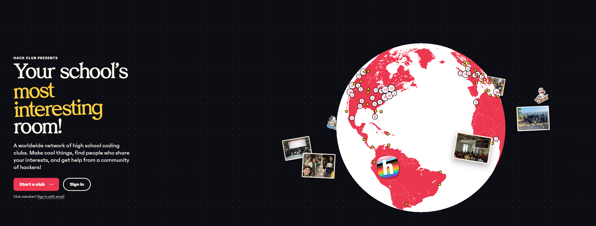

# opensourceclubs

da club around the world

I'm currently on the clubs team and as the current hackclub [clubs](https://hackclub.com/clubs) tab + [clubs](https://clubs.hackclub.com) site having the same ui kinda irked me, and knowing that there is an api that lists all the exisiting hack clubs around the world, I wanted to make this to replace one of the two!

It's a spinning globe that shows every active Hack Club, built to replace the clubs card on hackclub.com. The club locations come from Hack Club's public club API. The globe is made with MapLibre, an open source map library, using free OpenFreeMap tiles built on OpenStreetMap data. The page around it is a copy of the real hackclub.com, taken from its open source code (hackclub/site), with the globe swapped in. The site is built with SvelteKit.

To run it, install Node.js, then run `npm install` and `npm run dev`, and open http://localhost:5190/mock/hackclub/clubs.
